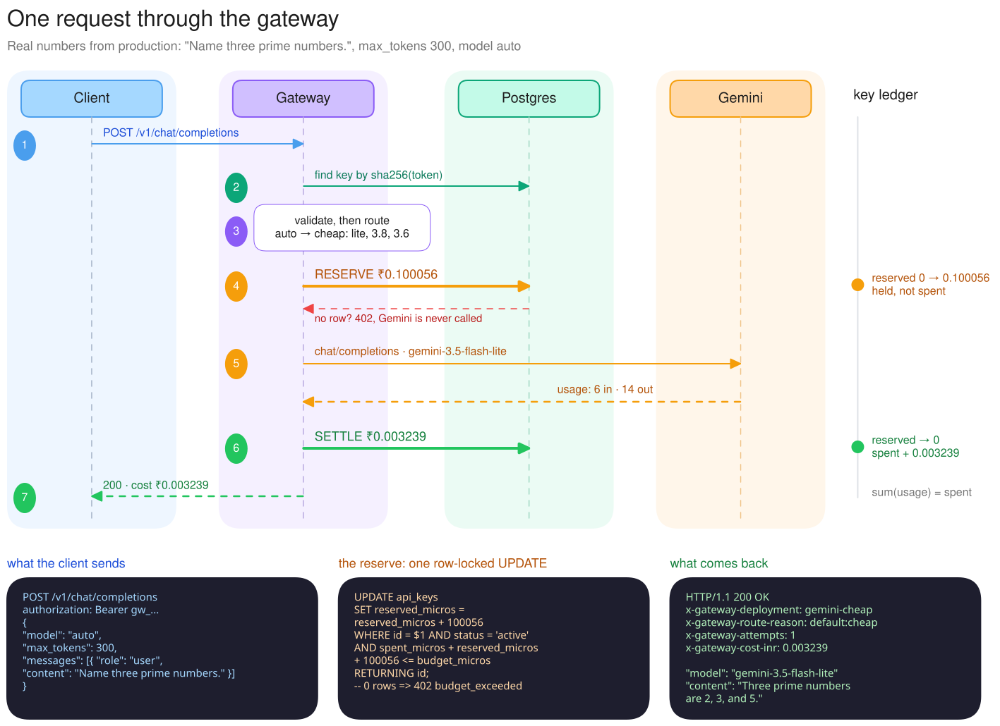

# DECISIONS

## What I built

An LLM gateway in TypeScript (Fastify + Postgres) that sits in front of Gemini and exposes an OpenAI-compatible `POST /v1/chat/completions`. Callers use keys the gateway issues. The real Gemini key never leaves the server.

Every key has a budget in rupees. Before a request touches Gemini, the gateway reserves the worst case it could cost, and afterwards it settles to what it actually cost. If the primary model fails, the request walks down a fallback chain guarded by a circuit breaker. Every request, success or failure, is one row in `usage_events`, so "how much has key X spent?" is a single query.

I started from an empty folder; no boilerplate.

## How one request moves through it



The numbers are from a real production request ("Name three prime numbers.", `max_tokens: 300`). The gateway reserved **₹0.100056**, the worst case across the fallback chain. Gemini Flash-Lite answered with 6 prompt and 14 completion tokens, and settle charged **₹0.003239** and released the hold. The editable source is `assets/request-lifecycle.excalidraw`; open it on excalidraw.com.

The steps:

1. **Auth** (`app.ts`). I hash the bearer token with sha256 and look it up by `key_hash`. The plaintext key is shown once when the key is created and never stored. A revoked key gets a 401.
2. **Validate.** A zod schema for the slice of the OpenAI format I support. `stream: true` or a `max_tokens` above the cap gets a clear 400 instead of being quietly ignored.
3. **Route** (`routing.ts`). `model` can be `auto`, a tier (`cheap` / `capable` / `local`), or a pinned deployment like `gemini-capable`. The result is an ordered chain plus a reason string, which ends up on the usage row and in the `x-gateway-route-reason` header.
4. **Reserve** (`store.ts`). The worst case is estimated input tokens plus the full `max_tokens` of output, priced at the most expensive deployment in the chain, since a fallback could land there. One conditional `UPDATE` holds that amount. If it matches no row, the key can't afford it and the caller gets a 402 before Gemini is ever called. The pending usage row goes in within the same transaction.
5. **Provider chain** (`gateway.ts`). Each deployment gets one attempt with its own timeout, inside an overall deadline. Deployments with an open breaker get skipped.
6. **Settle** (`store.ts`). Real tokens give the real cost, including Gemini's thinking tokens (more on that below). In one transaction the usage row gets marked `ok` or `error`, `reserved` drops by the hold, and `spent` goes up by the real cost. A failed request costs 0.
7. **Respond.** An OpenAI-shaped `chat.completion`, so the OpenAI SDK works by changing `base_url`, plus `x-gateway-deployment`, `x-gateway-attempts`, `x-gateway-cost-inr` and `x-request-id` headers.

A sweeper runs every minute and releases holds older than 5 minutes, which only happens if the process dies mid-request.

## The decisions that mattered

### 1. Budget in ₹, reserve then settle

**Options:** cap requests, cap tokens, or cap rupees. Check `spent < budget` before calling, or reserve first.

**Picked:** rupees, stored as integer micro-rupees, with worst-case reserve then settle.

**Why:** requests and tokens are proxies for what actually matters, which is money. On 3.8 Flash an output token costs 5× an input token, thinking tokens are billed as output, prices differ per model, and 3.8 Flash doubles in price on 2027-01-01. A plain "check, then call" also has a race (see Concurrency), and it only knows the cost after the money is gone. Reserving the worst case makes the budget a hard ceiling.

**Tradeoff:** it's pessimistic. A key with ₹0.01 left gets a 402 for a request that would really cost ₹0.002, because I hold the full `max_tokens`. The caller can lower `max_tokens` to fit. I used integer micro-rupees so sums never drift the way floats do.

### 2. Non-streaming

**Picked:** non-streaming. `stream: true` gets an explicit 400.

**Why:** I get the real `usage` block before replying, so settle is exact and happens in one transaction. Fallback is also clean: I can switch models without the client having half an answer from the first one. With streaming, usage arrives in the last chunk if it arrives at all, a failure mid-stream can't be retried transparently, and a client disconnect needs its own settle path.

**Tradeoff:** a worse time-to-first-token for chat UIs. Most traffic through a budgeted gateway is backend work (classification, extraction, batch jobs), where total latency matters more.

### 3. Usage logging is synchronous and in the same transaction as the balance

**Options:** fire-and-forget async logging, a queue plus a worker, or writing in the request path.

**Picked:** writing in the request path, in the same transaction as the balance update.

**Why:** the usage log is the budget. With async logging, a crash between replying and writing the log means spend that was served but never counted. That's exactly the silent pass-through the brief warns about. Keeping both in one transaction gives me an invariant I can test: `SUM(usage_events.cost) == api_keys.spent`.

**Tradeoff:** two small transactions on every request, a few milliseconds each. And if Postgres is down, the gateway fails closed: no reservation, no call. For a budget control that's the right default; the cost is availability.

### 4. Fallback: one attempt per deployment, no retrying the same one, plus a breaker

Details below under "Fallback policy".

### 5. OpenAI-compatible, but only a subset

**Picked:** `model`, `messages` (string content), `max_tokens` / `max_completion_tokens`, `temperature`, `top_p`, `stop`, `reasoning_effort`, `metadata.task`. Anything else I don't support (streaming, tools, images) fails loudly.

**Why:** callers keep the OpenAI SDK and just swap `base_url` and the key. Gemini, Groq, OpenRouter, vLLM and Ollama all speak this format, so one `OpenAICompatProvider` class covers all of them. Gateway metadata goes in headers, not the body, so strict SDK parsers don't break on extra fields.

**Tradeoff:** no tool calling and no images. Accepting the full schema and silently dropping parts of it is worse than rejecting it.

## Why enforce budgets at the gateway instead of trusting callers?

Because whoever pays isn't whoever makes the calls. A budget only means something if it's enforced by the component that holds the money and can't be bypassed, and the gateway is the only thing holding the real provider key.

If callers enforce their own limits, the cap is only as good as the worst caller's code: a buggy retry loop, an agent that keeps recursing, a key leaked on someone's laptop, or a teammate who never wrote the check. You find out from the invoice. Callers also can't enforce a shared limit properly. Ten pods of the same service each see only their own traffic. And they don't know the real price, because they don't know which model served them after a fallback.

The gateway sees every request, knows the real cost, is the one place a shared counter can be updated atomically, and can say no before money is spent. Same reason a bank checks your balance instead of taking your word for it.

## Concurrency: two requests on an almost-empty key

**Handled and tested.** Say ₹0.03 is left and two requests that each need ₹0.02 arrive at the same moment. Both run:

```sql
UPDATE api_keys SET reserved_micros = reserved_micros + $2
WHERE id = $1 AND status = 'active'
  AND spent_micros + reserved_micros + $2 <= budget_micros
RETURNING id;
```

Postgres locks the row. The first one commits, and `reserved` becomes ₹0.02. The second was waiting on the lock. Under READ COMMITTED, Postgres re-checks its `WHERE` against the newly committed row: 0.02 + 0.02 > 0.03, so no row matches and that request gets a 402. The check and the write are the same statement, so there's no read-then-write gap, and I didn't need `SERIALIZABLE` or advisory locks.

The test fires 25 requests at once at a key that can afford about 3. It checks that `spent <= budget`, that `reserved` is back to 0 afterwards, and that the usage rows add up to `spent`. Locally the suite runs on PGlite, which runs one query at a time, so locally it proves the accounting but not the locking. I also ran the whole suite against real Postgres 18 on Neon, in a separate `gateway_test` database, with up to 10 pooled connections fighting over the same row. Everything passed, and the concurrency test passed 5 out of 5 repeated runs.

**A known, bounded overshoot:** I estimate input tokens at about 3 characters per token. Settle charges the real number, so if the provider counts more (Hindi in Devanagari is close to 1 token per character), a key can end slightly over budget, by at most part of one request. The next request is then blocked. I'd rather record what really happened than clamp it.

## Fallback policy

| Requested | Order tried |
|---|---|
| `capable` | `gemini-3.8-flash` → `gemini-3.6-flash` → `gemini-3.5-flash-lite` → (mock, dev only) |
| `cheap` | `gemini-3.5-flash-lite` → `gemini-3.8-flash` → `gemini-3.6-flash` → (mock) |
| `local` | Ollama → Flash-Lite → Flash → (mock) |

A capable request falls back within its own tier first. 3.6 Flash is the previous generation at the same price, so the caller still gets the quality they asked for. Only after that does it drop to Flash-Lite.

I've seen it work twice for real:

- **Bad config.** I pointed the capable model at a name that doesn't exist. Gemini returned 404, Flash-Lite answered, and the response said `x-gateway-attempts: 2`.
- **A real outage on deploy day.** `gemini-3.8-flash` was returning 503s and hanging some requests for minutes. Production timed out the attempt, fell back, and still returned 200. That's why the same-tier fallback to 3.6 Flash exists. Before it, capable requests dropped straight to the lite model.

The rules:

- **One attempt per deployment, then move on.** The failures that actually happen (429 quota, 5xx outages, timeouts) don't get fixed by hitting the same model again 200 ms later. That only adds latency. Moving to different capacity is the retry. Each model also has its own free-tier quota, so a 429 on one usually works on the next.
- **Sort errors into two kinds.** Timeouts, network errors, 408, 429, 5xx and deployment-level 401/403/404 (bad key, model gone) try the next deployment. Request-level 400/413/422 stop right away with a 400, because a bad request fails the same way everywhere. One catch: Gemini returns a 400 for a bad API key. I detect that and treat it as our problem, not the caller's.
- **Timeouts:** 12 s per attempt and 28 s total, so two attempts fit. The cost: without streaming I can't tell a hung connection from a long answer still being generated, so a very long completion from a slow model gets cut off and retried elsewhere. Streaming would give a much better liveness signal (time to first token). The 28 s is deliberately under Render's 30 s shutdown grace period, which free instances can't extend, so on a redeploy every in-flight request finishes and settles before the process is killed. If one doesn't, the sweeper releases its hold.
- **Circuit breaker:** 3 failures in a row and a deployment is skipped for 30 s, then one probe gets through. During an outage this stops every request from waiting out a full timeout first. If every deployment in the chain is open, the caller gets an immediate 503 with `Retry-After`.
- **Clear errors:** 502 means everything failed, 503 means every breaker is open, 504 means the deadline was hit. The error body lists every attempt with its error and timing. Failed requests cost ₹0 and release their hold.
- **The mock never answers real users.** It's only in the chain when `ENABLE_MOCK_PROVIDER` is on, and that's off in production. A fake 200 is worse than an honest 502.
- **Fallback can cost more** (cheap falling back to capable), which is why the reservation uses the worst case across the whole chain.

The weakness I'm accepting: all three cloud models are Google's, so a Google-wide outage takes them all down. Adding a second vendor is about 3 lines of config, since the provider is generic OpenAI-compatible; I kept this build to one vendor.

## Gemini 3 things I only found by hitting the real API

On models: `gemini-3.8-flash` and `gemini-3.5-flash-lite` are the newest text models on the [pricing page](https://ai.google.dev/gemini-api/docs/pricing) as of 2026-10-12. Both show up in `GET /v1beta/models` for my key (`scripts/list-gemini-models.mjs`), and both can be changed through env vars.

1. **Thinking tokens are billed but missing from `completion_tokens`.** A raw call returned `prompt_tokens: 11, completion_tokens: 8, total_tokens: 207`. The other 188 are thinking tokens, and the pricing page says output is billed "including thinking tokens". Billing `completion_tokens` would have under-charged that call about 25×. The adapter bills `total − prompt` and reports the split as `completion_tokens_details.reasoning_tokens`, so `completion_tokens` means what OpenAI clients expect.
2. **Thinking eats `max_tokens`.** With `max_tokens: 30`, the model spent everything thinking and returned no text at all (`finish_reason: "length"`). I treat that as a valid, billed, cut-off answer, not a provider failure, so it doesn't trigger a fallback and get billed twice. The reservation is still a correct upper bound because `max_tokens` caps thinking and visible output together. In production, 3.6 Flash spent about 190 of a 200-token cap thinking and returned cut-off answers, so I set the default to 1024. Gemini 3 has no separate thinking budget, so a small `max_tokens` is a correctness problem, not just a cost cap.
3. **You can't turn thinking off on Gemini 3**, and `reasoning_effort: "minimal"` gets a 400 from 3.8 Flash even though the compatibility docs list it. I default to `low` (0 reasoning tokens on short prompts in my tests). Callers can send `low`, `medium` or `high`.
4. **There's a scheduled price change.** 3.8 Flash goes from $0.75/$3.75 to $1.50/$7.50 per 1M tokens on 2027-01-01. Prices carry effective dates, so budgets stay right across the change without a deploy.

## Stretch: cheap vs capable router (with a local model for classification)

`model: "auto"` runs a few ordered rules (`routing.ts:chooseTier`). The first match wins:

1. `metadata.task = "classification"`, or a system prompt about classifying, labelling, sentiment or intent with `max_tokens <= 64` and a short input: **local** Ollama if it's configured, otherwise **cheap**.
2. `metadata.task = "reasoning"`, an input over about 4K tokens, or code, debugging or "step by step" in the messages: **capable**.
3. Everything else: **cheap**.

Why rules instead of a classifier model: every decision is a string on the usage row (`route_reason`), so I can debug a bad route from the data alone, and the router costs no latency and no tokens. Defaulting to cheap is on purpose. Most traffic doesn't need the bigger model, and anyone who disagrees can ask for `capable`. A pinned or tier request is never overridden.

The Ollama gotcha: its default context window is small (2-4K depending on version), and it silently cuts the start of the prompt when you go over, which drops the system prompt first. Its OpenAI-compatible endpoint can't set `num_ctx`, so the adapter uses the native `/api/chat` and sets `num_ctx` per request, rounded up to a power of two so the model isn't reloaded for every size. A request that won't fit fails as retryable and falls through to the cloud.

## What I didn't build, on purpose

- **Streaming.** Reasons above.
- **Caching.** Exact-match hits are rare for chat, and semantic caching needs an embedding call, a vector index, and a real answer to "when is similar the same?". It's also the easiest way to serve wrong answers, so it's not worth it at this scope.
- **Per-key rate limits.** The budget caps money, not bursts. The same conditional-update pattern or a token bucket would do it; it's outside the brief, so I left it as the first item for next week.
- **Tools, images, the full OpenAI schema.** Rejected loudly instead.
- **Cancelling the Gemini call when the client disconnects.** We still pay for it, and it still settles correctly.
- **A migrations framework.** One idempotent `schema.sql` runs on boot. Fine for two tables; not fine once the schema starts changing.
- **A real frontend.** There's one static page at `/`: paste a key, see spend and recent requests, try a prompt. It has no framework and no build step, and it only calls the same public endpoints as any client, so it adds no backend surface. Model output is inserted as plain text, and a strict CSP allows only its own inline script, by hash.
- **Live price sync.** Prices are a hand-maintained, dated table in `pricing.ts`. Unknown models (including moving aliases like `gemini-flash-latest`) are priced high on purpose, so a config mistake over-reserves instead of under-charging.

## The decision I'm least sure about: reserving the worst case

**For it:** one SQL statement makes the budget a hard ceiling under any amount of concurrency. Reserving the expected cost instead lets ten parallel requests each fit on their own and overshoot together, which is the exact failure a budget is meant to prevent.

**Against it:** it's pessimistic in a way users notice. The default `max_tokens` is 1024 and real answers are often 100-200 tokens, so each request holds 5-10× what it ends up costing. With lots of concurrency on a small budget, keys get 402s while there's still money left, and the "remaining" number in that 402 looks wrong to them. A real system would probably reserve a percentile of that key's historical output length and accept a small overshoot, or offer a soft-limit mode.

I kept worst case because rejecting too early is visible and recoverable, while overspending is invisible until the invoice. The brief also says the budget has to actually block.

## Where it breaks, and what I'd do with another week

- **One hot row per key.** Every request on a key takes that row's lock twice. Fine at tens of requests per second per key; at thousands, that row is the bottleneck. I'd shard the balance into sub-counters, or move budgets into Redis with a Lua reserve script and reconcile to Postgres.
- **Breaker state lives in one process.** With several instances, each learns about an outage on its own. Shared state in Redis would fix that, or I accept it, since each instance catches on within 3 failed requests.
- **Render free-tier cold starts.** After 15 minutes idle the service sleeps, and the next request waits about a minute. My deadline only starts once the request reaches the process, but an impatient client may give up first. A paid instance or a keep-alive ping fixes it.
- **Free-tier Gemini quotas are small and shared per project, not per key.** From AI Studio for my project: 3.8 Flash and 3.6 Flash allow 5 requests a minute and 20 a day each; Flash-Lite allows 15 a minute and 500 a day. So the capable tier runs dry after about 40 requests a day. After that, capable requests hit 429, fall through to Flash-Lite, and the breaker stops hammering the exhausted models. So the chain does double duty: it covers outages, and it spreads one small free quota across three separate per-model allowances. But every key shares the same quota, so one heavy key can use up everyone's capable tier. Per-key rate limits are the fix.
- **One vendor.** I'd add Groq or OpenRouter as a third provider.
- **The router saves less than it used to.** In the 3.x generation, Flash-Lite is 2.5× cheaper on input but only 1.5× cheaper on output. The older `gemini-3.1-flash-lite` ($0.25/$1.50) would save more; switching is a one-line env change, and whether its quality holds up is the eval I'd run next.
- With the week: streaming with settle on the final chunk and on disconnect, per-key rate limits, per-key model allow-lists, OpenTelemetry traces per attempt, a load test on real Postgres to find the lock-contention ceiling, and an eval of the router on real traffic.

## Security notes

- Provider keys exist only as env vars on the host. `.env` is git-ignored, and `render.yaml` marks the secrets `sync: false`.
- Virtual keys have 256 bits of randomness, and only their sha256 is stored. Bcrypt exists to protect weak passwords; here it would add about 100 ms per request for nothing.
- The admin token is compared with `timingSafeEqual`. `Authorization` headers are redacted from logs, and upstream error bodies are truncated before they're logged or returned.
- Postgres connects with `sslmode=verify-full`. `pg`'s next major version will make `require` skip certificate checks, so I pin full verification explicitly.
